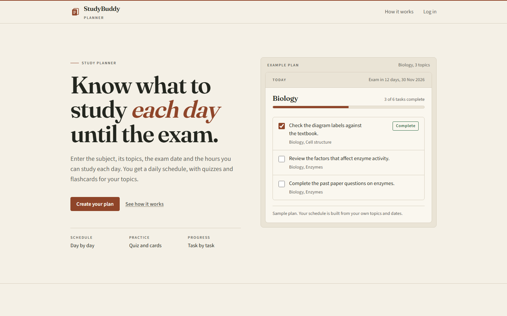

# StudyBuddy

StudyBuddy turns a subject, its topics, an exam date and a daily study budget into a day by day plan, with quizzes and flashcards for each topic. You work through the plan, tick off tasks, and the app shows completed tasks, overall progress and a daily streak.



## The problem it solves

Most students know what the exam covers. What they struggle with is deciding what to study today, in what order, and how much. Notes and topic lists do not turn themselves into a schedule, so revision starts late or drifts between subjects.

StudyBuddy closes that gap. You enter the exam date and the hours you can actually study each day. The app spreads your topics across the days you have, puts the harder topics earlier, keeps the last days for revision, and gives you practice material per topic. The plan is specific enough to act on without planning it yourself.

## Features

- Account registration and sign in with a JSON Web Token.
- Plan creation from a subject, a topic list, an exam date and hours per day.
- An AI generated schedule of dated tasks, one to three per study day.
- Task completion with progress and streak tracking.
- A five question multiple choice quiz per topic.
- An eight card flashcard deck per topic.
- Document summaries from a PDF, DOCX, PPTX, TXT, MD or CSV file, or from a PNG, JPG or WEBP image, with a prompt that sets the format.
- Saved plans, saved practice material and account deletion.

## Tech stack

| Layer | Tools |
| --- | --- |
| Client | React 19, Vite, React Router, Axios, Tailwind CSS, Recharts, Phosphor Icons |
| API | Node.js 20+, Express 5, Mongoose, helmet, express-rate-limit, zod, morgan, multer, fflate, unpdf |
| Auth | bcrypt password hashing, jsonwebtoken |
| Database | MongoDB Atlas |
| AI | Groq as the main provider, Google Gemini as the backup |
| Hosting | Render for the API, Vercel for the client, MongoDB Atlas for the database |

## Repository layout

```
/
  AGENTS.md            product, design and security rules
  README.md
  render.yaml          Render Blueprint for the API
  docs/
    DEPLOYMENT.md      step by step deployment guide
    screenshot.png
    DESIGN.md
  client/              React and Vite client
  server/              Express API
```

## Run it locally

You need Node.js 20 or newer, npm, and a MongoDB connection string (MongoDB Atlas free tier or a local `mongod`).

### 1. API

```
cd server
npm install
copy .env.example .env
```

On macOS or Linux use `cp .env.example .env`. Fill in the values listed under [Environment variables](#environment-variables), then start the server:

```
npm run dev
```

The API listens on `http://localhost:5000` and exposes `GET /api/health`.

### 2. Client

In a second terminal:

```
cd client
npm install
copy .env.example .env
npm run dev
```

Set `VITE_API_URL` to the API origin, for example `http://localhost:5000`, with no `/api` suffix. The client appends `/api` itself.

Open `http://localhost:5173`, register an account, and create a plan. The client calls `${VITE_API_URL}/api`. If `VITE_API_URL` is unset it falls back to `http://localhost:5000`.

## Environment variables

Names only. The values stay in `.env` files, which are not committed. `server/.env.example` and `client/.env.example` list the same names.

Server (`server/.env`):

```
NODE_ENV
PORT
MONGODB_URI
JWT_SECRET
AI_PROVIDER
GROQ_API_KEY
GROQ_MODEL
GEMINI_API_KEY
GEMINI_MODEL
GEMINI_FALLBACK_MODEL
AI_DAILY_LIMIT
CLIENT_URL
```

Client (`client/.env`):

```
VITE_API_URL
```

The API validates these at startup and exits with a named error when a required one is missing or invalid. `CLIENT_URL` takes exact origins only, comma separated, with no wildcard and no path.

## API routes

All routes are under `/api`. Routes marked Auth need an `Authorization: Bearer <token>` header.

| Method | Route | Purpose | Auth |
| --- | --- | --- | --- |
| GET | `/api/health` | Service health check | No |
| POST | `/api/auth/register` | Create an account and return a token | No |
| POST | `/api/auth/login` | Sign in and return a token | No |
| GET | `/api/auth/me` | Return the signed in user | Yes |
| DELETE | `/api/auth/me` | Delete the account and its data | Yes |
| GET | `/api/plans` | List the user's plans | Yes |
| POST | `/api/plans` | Generate a plan and its schedule | Yes |
| GET | `/api/plans/:id` | Return one plan with its tasks | Yes |
| GET | `/api/plans/:id/progress` | Return progress and streak for a plan | Yes |
| DELETE | `/api/plans/:id` | Delete a plan and its tasks | Yes |
| PATCH | `/api/tasks/:id/toggle` | Mark a task complete or incomplete | Yes |
| POST | `/api/ai/quiz` | Generate a quiz for a plan topic | Yes |
| GET | `/api/ai/quiz` | List saved quizzes for a plan | Yes |
| POST | `/api/ai/flashcards` | Generate a flashcard deck for a plan topic | Yes |
| GET | `/api/ai/flashcards` | List saved decks for a plan | Yes |
| POST | `/api/documents/summarize` | Summarize one uploaded document | Yes |

Errors return a JSON body with an `error.message` string. Auth, plan and AI routes have stricter rate limits than the general API.

## AI usage

Groq powers schedule, quiz and flashcard generation. The API sends the generation request to Groq first. If Groq is rate limited, returns a service error or times out, the request is retried once, then sent to Google Gemini as the backup provider, but only when `GEMINI_API_KEY` is set.

Document summaries use the same provider order for text. Images and scanned PDFs without a text layer go to Gemini directly, because those files need a multimodal model. When `GEMINI_API_KEY` is not set, the page says that images and scanned PDFs cannot be summarized right now.

`AI_PROVIDER` chooses the main provider, `groq` by default. `GROQ_MODEL` defaults to `openai/gpt-oss-120b`. Setting `AI_PROVIDER=gemini` swaps the order. Only the key of the provider in use is required, and the server refuses to start when none is configured.

What is sent to the provider:

- Plan generation: the subject, the topics, the exam date, the hours per day and the start date.
- Quiz generation: the topic and the number of questions.
- Flashcard generation: the topic and the number of cards.
- Document summaries: the summary prompt and the extracted text, capped at 16,000 characters, or the image or scanned PDF itself. Uploaded files stay in memory for the request and are not stored. One file per request, up to 10 MB, with a 60 page limit for PDFs.

What is never sent: the user's name, email address, password, token or any other account data. The browser never holds an AI key. It calls this API, and the API calls the provider. All provider code lives in `server/services/ai.js`.

Provider output is treated as untrusted input. It is parsed, validated with zod and normalised before it is stored or returned, then rendered as plain text. Provider requests run one at a time with a small output cap, so a request stays inside Groq's free tier token limit.

This project was built for the STEM2Connect AI Hackathon, Education track. OpenCode, with an AI coding assistant, helped write the code, the tests and the documentation. Every change was reviewed and verified against the running app.

## Deployment

The full guide is in [docs/DEPLOYMENT.md](docs/DEPLOYMENT.md). The short version:

1. Create a MongoDB Atlas cluster, a database user and a connection string.
2. On Render, create a Blueprint from this repository. `render.yaml` builds the API from `server/` and health checks `/api/health`.
3. On Vercel, import the repository with `client` as the root directory. `client/vercel.json` handles the Vite build and the single page app rewrite.
4. Set `CLIENT_URL` on Render to the exact Vercel origin, and `VITE_API_URL` on Vercel to the exact Render origin.

## Tests

```
cd server
npm test
```

The API suite runs offline. Provider calls are mocked, so it never reaches Groq, Gemini or the network.

```
cd client
npm run lint
npm run build
```
